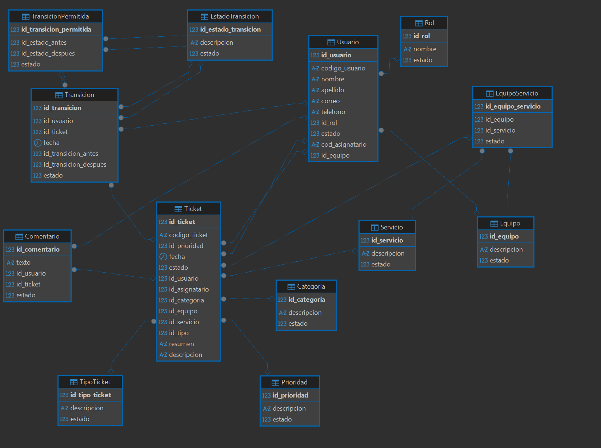

# Caso Propuesto: Sistema de Gestión de Tickets ITSM

Resumen ejecutivo del proyecto.

---

## Contexto: Banco Andino

**Banco Andino** es una entidad financiera ficticia con más de 25 años de trayectoria, presencia en todo el país y millones de clientes que cada día consultan sus saldos, transfieren dinero y pagan servicios desde la **banca móvil**, la **banca web** y los cajeros automáticos. Detrás de esa experiencia trabajan cientos de profesionales de tecnología, organizados en equipos especializados: Canales Digitales, Core Bancario, Seguridad, Devops y Cloud.

En los últimos años el banco creció rápido. Migró parte de su plataforma a la nube, lanzó nuevas funcionalidades en sus aplicaciones y amplió su equipo de TI. Con ese crecimiento aumentaron también las solicitudes y los incidentes: accesos que no funcionan, cambios que deben planificarse, fallas que afectan a clientes. Hasta hoy, todo eso llega por **correos y mensajes** que se pierden entre bandejas de entrada.

### La decisión

La gerencia de TI decide dejar de depender de correos y mensajes sueltos, y **centralizar la gestión de solicitudes e incidentes en un sistema único** donde cada caso quede registrado, asignado, clasificado y con todo su historial a la vista. Este proyecto nace para hacerlo realidad.

---

## 1. Introducción y solución

Se propone implementar un sistema centralizado para registrar, organizar y dar seguimiento al ciclo de vida de las solicitudes e incidentes de TI.

- **Modelo:** relacional, garantizando integridad referencial.
- **Plataforma:** Microsoft Azure SQL Database.
- **Alcance:** gestión de tickets ITSM, comentarios y transiciones.
- **Fuera de alcance:** subtareas y varios equipos resolutores por ticket.

## 2. Problemática actual

La gestión mediante correos y mensajes genera descentralización y falta de visibilidad en:

- Identificación de solicitantes y responsables asignados.
- Clasificación de impacto, prioridad y servicios afectados.
- Trazabilidad de estados, cambios e historial de atención.
- Tiempos de respuesta y registro de comentarios.

## 3. Objetivo general

Diseñar e implementar un sistema ITSM integral para **clasificar, atender y auditar solicitudes e incidentes**, asegurando la trazabilidad completa en cada etapa de su ciclo de vida.

## 4. Objetivos específicos

- **Gestión de accesos:** usuarios, roles y asignaciones.
- **Infraestructura:** catálogo de servicios e inventario de equipos.
- **Operación:** tipificación, priorización y comentarios en tickets.
- **Control:** historial de transiciones y comentarios.

---

## 5. Catálogos del sistema

Datos de negocio con los que se puebla el sistema inicialmente.

### Categorías de atención

Clasificación temática de los incidentes:

- Aplicaciones y Base de Datos
- Redes y Comunicaciones
- Seguridad de la Información
- Accesos y Permisos
- Infraestructura

### Tipos de ticket

Tipificación según impacto y flujo:

- **Incidente:** falla o interrupción.
- **Requerimiento:** solicitud de servicio.
- **Problema:** causa raíz recurrente.
- **Cambio:** modificación planeada.

### Equipos solucionadores

Unidades operativas de atención:

- Canales Digitales
- Core Bancario
- Seguridad
- Devops
- Cloud

### Catálogo de servicios

Servicios de TI soportados:

- Aplicación Banca Móvil
- Aplicación Banca Web
- Plataforma Core Bancario
- Azure
- Onpremise
- Accesos

### Ciclo de vida (estados)

Etapas de gestión del ticket:

- **Fase inicial:** Nuevo, Asignado.
- **Atención:** En Progreso, En Espera.
- **Cierre:** Resuelto, Cerrado.
- **Excepción:** Cancelado.

### Roles de usuario

Perfiles con acceso al sistema:

- **Software Engineer:** resolutor técnico.
- **Team Leader:** gestión y asignación.
- **Operador:** registro y monitoreo.
- **Proveedor:** soporte externo.

---

## 6. Reglas de negocio

### Reglas de transición de estados

Definen las rutas permitidas para garantizar la trazabilidad y el control de calidad operativa.

**Flujo operativo secuencial:**

| Inicio | Atención | Cierre |
|---|---|---|
| Nuevo → Asignado | En Progreso / En Espera | Resuelto → Cerrado |

- **Inicio:** un ticket *Nuevo* debe pasar obligatoriamente a *Asignado*.
- **Atención:** desde *Asignado* se inicia la solución (*En Progreso*) o se suspende temporalmente (*En Espera*).
- **Pausa y reasignación:** desde *En Espera* se puede retomar la atención (*En Progreso*) o devolver a cola (*Asignado*).
- **Cierre:** la resolución (*Resuelto*) solo proviene de *En Progreso* y habilita el paso a *Cerrado*.

**Regla especial de cancelación:** cualquier ticket activo en estado *Nuevo*, *Asignado*, *En Progreso*, *En Espera* o *Resuelto* puede ser interrumpido y pasar a *Cancelado* en cualquier momento.

### Matriz de cobertura servicio – equipo

Restringe el enrutamiento de tickets asignando explícitamente qué equipos atienden cada servicio.

| Equipo | Servicios que atiende |
|---|---|
| Canales Digitales | Aplicación Banca Móvil, Aplicación Banca Web |
| Core Bancario | Plataforma Core Bancario, Onpremise |
| Seguridad | Accesos, Azure |
| DevOps | Onpremise, Azure |
| Cloud | Azure |

# Diagrama de Entidad Relacion

# Diagrama Logico

# Diagrama Fisico

# Diccionario de datos

Fuente: [DDL/create_database_itsm.sql](DDL/create_database_itsm.sql). Todas las tablas pertenecen al esquema `modelado` (SQL Server / Azure SQL).

**Convenciones generales:**

- **PK:** clave primaria · **FK:** clave foránea · **UQ:** restricción única · **CK:** restricción de validación.
- Las claves primarias son `INT` sin `IDENTITY`; los identificadores se asignan explícitamente en la carga.
- El campo `estado` es un indicador lógico en todas las tablas: `1` = Activo, `0` = Inactivo (`CHECK estado IN (0, 1)`).

## Resumen de tablas

| # | Tabla | Descripción |
|---|---|---|
| 1 | `Rol` | Roles que puede tener un usuario. |
| 2 | `Equipo` | Equipos de soporte que atienden tickets. |
| 3 | `Usuario` | Personas que registran o atienden tickets. |
| 4 | `Categoria` | Clasificación temática de los tickets. |
| 5 | `Prioridad` | Niveles de prioridad de los tickets. |
| 6 | `TipoTicket` | Tipos de ticket (p. ej. incidente, requerimiento). |
| 7 | `Servicio` | Servicios de TI sobre los que se solicita soporte. |
| 8 | `EquipoServicio` | Matriz de cobertura: qué equipo atiende qué servicio (N:M). |
| 9 | `EstadoTransicion` | Catálogo de estados del ciclo de vida del ticket. |
| 10 | `TransicionPermitida` | Cambios de estado válidos (estado antes → estado después). |
| 11 | `Ticket` | Solicitud/incidente registrado en el sistema. |
| 12 | `Comentario` | Comentarios asociados a un ticket. |
| 13 | `Transicion` | Historial de cambios de estado de cada ticket. |

## 1. Rol

Roles de los usuarios del sistema.

| Columna | Tipo | Nulo | Clave | Descripción |
|---|---|---|---|---|
| `id_rol` | INT | No | PK | Identificador del rol. |
| `nombre` | VARCHAR(100) | No | UQ | Nombre del rol (único). |
| `estado` | INT | Sí | CK | 1 = Activo, 0 = Inactivo. |

## 2. Equipo

Equipos de soporte.

| Columna | Tipo | Nulo | Clave | Descripción |
|---|---|---|---|---|
| `id_equipo` | INT | No | PK | Identificador del equipo. |
| `descripcion` | VARCHAR(50) | Sí | | Nombre/descripción del equipo. |
| `estado` | INT | Sí | CK | 1 = Activo, 0 = Inactivo. |

## 3. Usuario

Usuarios que solicitan o atienden tickets.

| Columna | Tipo | Nulo | Clave | Descripción |
|---|---|---|---|---|
| `id_usuario` | INT | No | PK | Identificador del usuario. |
| `codigo_usuario` | VARCHAR(10) | Sí | | Código funcional del usuario. |
| `nombre` | VARCHAR(100) | Sí | | Nombres. |
| `apellido` | VARCHAR(100) | Sí | | Apellidos. |
| `correo` | VARCHAR(100) | Sí | | Correo electrónico. |
| `telefono` | VARCHAR(11) | Sí | | Teléfono de contacto. |
| `id_rol` | INT | Sí | FK → `Rol.id_rol` | Rol del usuario. |
| `estado` | INT | Sí | CK | 1 = Activo, 0 = Inactivo. |
| `cod_asignatario` | VARCHAR(10) | Sí | | Código de asignatario (usuarios que atienden tickets). |
| `id_equipo` | INT | Sí | FK → `Equipo.id_equipo` | Equipo al que pertenece el usuario. |

**Restricciones adicionales:**

- `UQ_Usuario_usuario_equipo` — `UNIQUE (id_usuario, id_equipo)`: permite que `Ticket` referencie el par (usuario, equipo).

## 4. Categoria

| Columna | Tipo | Nulo | Clave | Descripción |
|---|---|---|---|---|
| `id_categoria` | INT | No | PK | Identificador de la categoría. |
| `descripcion` | VARCHAR(50) | Sí | | Nombre de la categoría. |
| `estado` | INT | Sí | CK | 1 = Activo, 0 = Inactivo. |

## 5. Prioridad

| Columna | Tipo | Nulo | Clave | Descripción |
|---|---|---|---|---|
| `id_prioridad` | INT | No | PK | Identificador de la prioridad. |
| `descripcion` | VARCHAR(20) | Sí | | Nombre de la prioridad. |
| `estado` | INT | Sí | CK | 1 = Activo, 0 = Inactivo. |

## 6. TipoTicket

| Columna | Tipo | Nulo | Clave | Descripción |
|---|---|---|---|---|
| `id_tipo_ticket` | INT | No | PK | Identificador del tipo de ticket. |
| `descripcion` | VARCHAR(20) | Sí | | Nombre del tipo de ticket. |
| `estado` | INT | Sí | CK | 1 = Activo, 0 = Inactivo. |

## 7. Servicio

| Columna | Tipo | Nulo | Clave | Descripción |
|---|---|---|---|---|
| `id_servicio` | INT | No | PK | Identificador del servicio. |
| `descripcion` | VARCHAR(50) | Sí | | Nombre del servicio. |
| `estado` | INT | Sí | CK | 1 = Activo, 0 = Inactivo. |

## 8. EquipoServicio

Tabla asociativa de la relación N:M entre `Equipo` y `Servicio` (matriz de cobertura).

| Columna | Tipo | Nulo | Clave | Descripción |
|---|---|---|---|---|
| `id_equipo_servicio` | INT | No | PK | Identificador de la cobertura. |
| `id_equipo` | INT | No | FK → `Equipo.id_equipo` | Equipo que atiende el servicio. |
| `id_servicio` | INT | No | FK → `Servicio.id_servicio` | Servicio atendido. |
| `estado` | INT | Sí | CK | 1 = Activo, 0 = Inactivo. |

**Restricciones adicionales:**

- `UQ_EquipoServicio_equipo_servicio` — `UNIQUE (id_equipo, id_servicio)`: evita duplicados y habilita la FK compuesta desde `Ticket`.

## 9. EstadoTransicion

Catálogo de estados del ticket.

| Columna | Tipo | Nulo | Clave | Descripción |
|---|---|---|---|---|
| `id_estado_transicion` | INT | No | PK | Identificador del estado. |
| `descripcion` | VARCHAR(20) | Sí | | Nombre del estado (Nuevo, Asignado, En Progreso, etc.). |
| `estado` | INT | Sí | CK | 1 = Activo, 0 = Inactivo. |

## 10. TransicionPermitida

Define los cambios de estado válidos del flujo operativo.

| Columna | Tipo | Nulo | Clave | Descripción |
|---|---|---|---|---|
| `id_transicion_permitida` | INT | No | PK | Identificador de la transición permitida. |
| `id_estado_antes` | INT | No | FK → `EstadoTransicion.id_estado_transicion` | Estado de origen. |
| `id_estado_despues` | INT | No | FK → `EstadoTransicion.id_estado_transicion` | Estado de destino. |
| `estado` | INT | No | CK | 1 = Activo, 0 = Inactivo. |

**Restricciones adicionales:**

- `UQ_TransicionPermitida` — `UNIQUE (id_estado_antes, id_estado_despues)`: cada par origen/destino se define una sola vez.

## 11. Ticket

Entidad central del sistema.

| Columna | Tipo | Nulo | Clave | Descripción |
|---|---|---|---|---|
| `id_ticket` | INT | No | PK | Identificador del ticket. |
| `codigo_ticket` | VARCHAR(10) | Sí | | Código funcional del ticket. |
| `id_prioridad` | INT | Sí | FK → `Prioridad.id_prioridad` | Prioridad del ticket. |
| `fecha` | DATETIME | Sí | | Fecha y hora de registro. |
| `estado` | INT | Sí | CK | 1 = Activo, 0 = Inactivo. |
| `id_usuario` | INT | Sí | FK → `Usuario.id_usuario` | Usuario que registra/solicita el ticket. |
| `id_asignatario` | INT | Sí | FK → `Usuario.id_usuario` | Usuario que atiende el ticket. |
| `id_categoria` | INT | Sí | FK → `Categoria.id_categoria` | Categoría del ticket. |
| `id_equipo` | INT | Sí | FK → `Equipo.id_equipo` (vía `EquipoServicio`) | Equipo asignado. |
| `id_servicio` | INT | Sí | FK → `Servicio.id_servicio` | Servicio afectado/solicitado. |
| `id_tipo` | INT | Sí | FK → `TipoTicket.id_tipo_ticket` | Tipo de ticket. |
| `resumen` | VARCHAR(100) | Sí | | Resumen breve del ticket. |
| `descripcion` | TEXT | Sí | | Descripción detallada. |

**Claves foráneas compuestas y reglas de integridad:**

| Restricción | Definición | Regla de negocio |
|---|---|---|
| `FK_Ticket_AsignatarioEquipo` | `(id_asignatario, id_equipo)` → `Usuario (id_usuario, id_equipo)` | El asignatario debe pertenecer al equipo del ticket. |
| `FK_Ticket_EquipoServicio` | `(id_equipo, id_servicio)` → `EquipoServicio (id_equipo, id_servicio)` | El equipo debe dar soporte al servicio del ticket. |
| `CK_Ticket_asignatario_equipo` | `id_asignatario IS NULL OR id_equipo IS NOT NULL` | Un ticket asignado debe tener equipo. |
| `CK_Ticket_equipo_servicio` | `id_equipo IS NULL OR id_servicio IS NOT NULL` | Un ticket con equipo debe tener servicio. |

## 12. Comentario

| Columna | Tipo | Nulo | Clave | Descripción |
|---|---|---|---|---|
| `id_comentario` | INT | No | PK | Identificador del comentario. |
| `texto` | TEXT | Sí | | Contenido del comentario. |
| `id_usuario` | INT | Sí | FK → `Usuario.id_usuario` | Usuario que registra el comentario. |
| `id_ticket` | INT | Sí | FK → `Ticket.id_ticket` | Ticket comentado. |
| `estado` | INT | Sí | CK | 1 = Activo, 0 = Inactivo. |

## 13. Transicion

Historial de cambios de estado de un ticket.

| Columna | Tipo | Nulo | Clave | Descripción |
|---|---|---|---|---|
| `id_transicion` | INT | No | PK | Identificador de la transición. |
| `id_usuario` | INT | Sí | FK → `Usuario.id_usuario` | Usuario que realiza el cambio de estado. |
| `id_ticket` | INT | Sí | FK → `Ticket.id_ticket` | Ticket afectado. |
| `fecha` | DATETIME | Sí | | Fecha y hora del cambio. |
| `id_transicion_antes` | INT | Sí | FK → `EstadoTransicion.id_estado_transicion` | Estado previo del ticket. |
| `id_transicion_despues` | INT | Sí | FK → `EstadoTransicion.id_estado_transicion` | Estado posterior del ticket. |
| `estado` | INT | Sí | CK | 1 = Activo, 0 = Inactivo. |

**Restricciones adicionales:**

- `FK_Transicion_TransicionPermitida` — `(id_transicion_antes, id_transicion_despues)` → `TransicionPermitida (id_estado_antes, id_estado_despues)`: solo se registran cambios de estado definidos como permitidos.

## Relaciones entre tablas

| Tabla origen | Columna | Tabla destino | Cardinalidad |
|---|---|---|---|
| `Usuario` | `id_rol` | `Rol` | N:1 |
| `Usuario` | `id_equipo` | `Equipo` | N:1 |
| `EquipoServicio` | `id_equipo` | `Equipo` | N:1 |
| `EquipoServicio` | `id_servicio` | `Servicio` | N:1 |
| `TransicionPermitida` | `id_estado_antes` / `id_estado_despues` | `EstadoTransicion` | N:1 (cada una) |
| `Ticket` | `id_prioridad` | `Prioridad` | N:1 |
| `Ticket` | `id_usuario` | `Usuario` | N:1 (solicitante) |
| `Ticket` | `id_asignatario` | `Usuario` | N:1 (atiende) |
| `Ticket` | `id_categoria` | `Categoria` | N:1 |
| `Ticket` | `id_servicio` | `Servicio` | N:1 |
| `Ticket` | `id_tipo` | `TipoTicket` | N:1 |
| `Ticket` | `(id_equipo, id_servicio)` | `EquipoServicio` | N:1 |
| `Comentario` | `id_usuario` | `Usuario` | N:1 |
| `Comentario` | `id_ticket` | `Ticket` | N:1 |
| `Transicion` | `id_usuario` | `Usuario` | N:1 |
| `Transicion` | `id_ticket` | `Ticket` | N:1 |
| `Transicion` | `id_transicion_antes` / `id_transicion_despues` | `EstadoTransicion` | N:1 (cada una) |
| `Transicion` | `(id_transicion_antes, id_transicion_despues)` | `TransicionPermitida` | N:1 |