# Respuestas — Laboratorio SQL Server ITSM

Resultados de las consultas de [preguntas.md](./preguntas.md)

---

## Pregunta 1 — Tickets activos desde el 2026-09-29

```sql
SELECT
    codigo_ticket,
    fecha,
    id_prioridad,
    id_equipo
FROM modelado.Ticket
WHERE estado = 1
  AND fecha >= '2026-09-29'
ORDER BY fecha DESC;
```
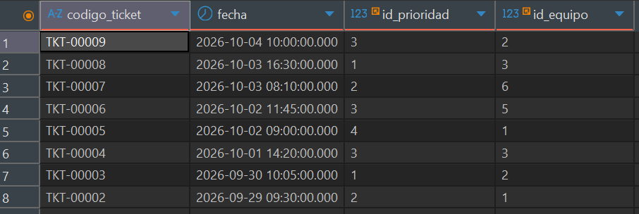


## Pregunta 2 — Resumen general de tickets

```sql
SELECT
    COUNT(*)                                  AS TotalTickets,
    COUNT(CASE WHEN estado = 1 THEN 1 END)    AS TicketsActivos,
    COUNT(CASE WHEN estado = 0 THEN 1 END)    AS TicketsInactivos,
    MIN(fecha)                                AS PrimerTicket,
    MAX(fecha)                                AS UltimoTicket
FROM modelado.Ticket;
```

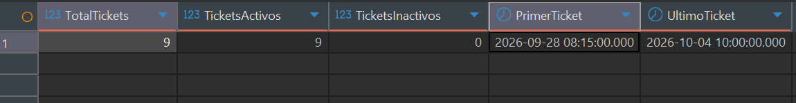

## Pregunta 3 — Tickets por categoría

```sql
SELECT
    c.descripcion      AS Categoria,
    COUNT(t.id_ticket) AS CantidadTickets
FROM modelado.Categoria c
LEFT JOIN modelado.Ticket t
       ON t.id_categoria = c.id_categoria
GROUP BY c.descripcion
ORDER BY CantidadTickets DESC, Categoria;
```
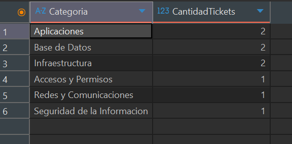

## Pregunta 4 — Carga de trabajo por equipo (2 o más tickets)

```sql
SELECT
    e.descripcion                  AS Equipo,
    COUNT(*)                       AS CantidadTickets,
    COUNT(DISTINCT t.id_asignatario) AS AsignatariosDistintos
FROM modelado.Ticket t
INNER JOIN modelado.Equipo e
        ON e.id_equipo = t.id_equipo
GROUP BY e.descripcion
HAVING COUNT(*) >= 2
ORDER BY CantidadTickets DESC, Equipo;
```
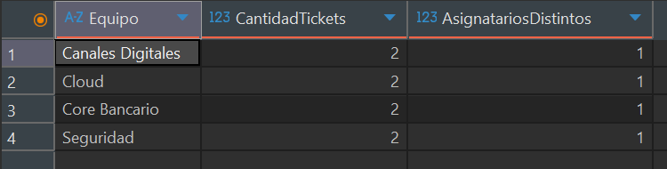

## Pregunta 5 — Cuello de botella por ticket

```sql
WITH tiempos AS (
    SELECT
        tr.id_ticket,
        tr.id_transicion_antes,
        tr.id_transicion_despues,
        DATEDIFF(
            MINUTE,
            LAG(tr.fecha) OVER (PARTITION BY tr.id_ticket ORDER BY tr.fecha),
            tr.fecha
        ) AS minutos
    FROM modelado.Transicion tr
),
ranking AS (
    SELECT
        *,
        ROW_NUMBER() OVER (PARTITION BY id_ticket ORDER BY minutos DESC) AS ranking
    FROM tiempos
    WHERE minutos IS NOT NULL  
)
SELECT
    t.codigo_ticket  AS CodigoTicket,
    ea.descripcion   AS EstadoAntes,
    ed.descripcion   AS EstadoDespues,
    r.minutos        AS Minutos,
    r.ranking        AS Ranking
FROM ranking r
INNER JOIN modelado.Ticket t             ON t.id_ticket = r.id_ticket
INNER JOIN modelado.EstadoTransicion ea  ON ea.id_estado_transicion = r.id_transicion_antes
INNER JOIN modelado.EstadoTransicion ed  ON ed.id_estado_transicion = r.id_transicion_despues
WHERE r.ranking = 1
ORDER BY t.codigo_ticket;
```
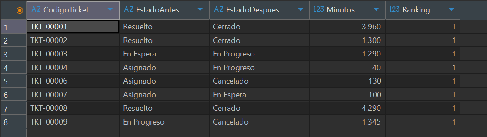

## Pregunta 6 — Asignatario más cargado por equipo

```sql
WITH carga AS (
    SELECT
        t.id_equipo,
        t.id_asignatario,
        COUNT(*) AS tickets
    FROM modelado.Ticket t
    WHERE t.id_asignatario IS NOT NULL
    GROUP BY t.id_equipo, t.id_asignatario
),
ranking AS (
    SELECT
        *,
        SUM(tickets) OVER (PARTITION BY id_equipo) AS total_equipo,
        DENSE_RANK() OVER (PARTITION BY id_equipo ORDER BY tickets DESC) AS ranking
    FROM carga
)
SELECT
    e.descripcion               AS Equipo,
    u.nombre + ' ' + u.apellido AS Asignatario,
    r.tickets                   AS Tickets,
    CAST(100.0 * r.tickets / r.total_equipo AS DECIMAL(5,2)) AS PctDelEquipo,
    r.ranking                   AS Ranking
FROM ranking r
INNER JOIN modelado.Equipo e  ON e.id_equipo  = r.id_equipo
INNER JOIN modelado.Usuario u ON u.id_usuario = r.id_asignatario
WHERE r.ranking = 1
ORDER BY e.descripcion, Asignatario;
```
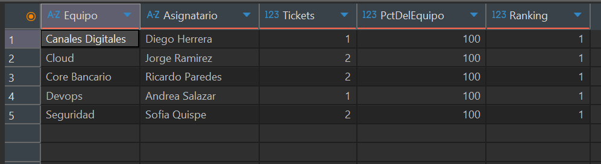

## Pregunta 7 — Procedimiento almacenado: cambiar el estado de un ticket

**Paso 1 — Crear el procedimiento**

```sql
CREATE OR ALTER PROCEDURE modelado.usp_CambiarEstadoTicket
    @id_ticket       INT,
    @id_usuario      INT,
    @id_estado_nuevo INT,
    @fecha           DATETIME = NULL
AS
BEGIN
    SET NOCOUNT ON;

    SET @fecha = ISNULL(@fecha, GETDATE());

    IF NOT EXISTS (SELECT 1 FROM modelado.Ticket
                   WHERE id_ticket = @id_ticket AND estado = 1)
        THROW 50001, 'El ticket no existe o esta inactivo.', 1;

    IF NOT EXISTS (SELECT 1 FROM modelado.Usuario
                   WHERE id_usuario = @id_usuario AND estado = 1)
        THROW 50002, 'El usuario no existe o esta inactivo.', 1;

    DECLARE @id_estado_actual INT =
        ISNULL((SELECT TOP (1) id_transicion_despues
                FROM modelado.Transicion
                WHERE id_ticket = @id_ticket
                ORDER BY fecha DESC, id_transicion DESC), 1);   -- 1 = Nuevo

    IF NOT EXISTS (SELECT 1 FROM modelado.TransicionPermitida
                   WHERE id_estado_antes   = @id_estado_actual
                     AND id_estado_despues = @id_estado_nuevo
                     AND estado = 1)
        THROW 50003, 'La transicion solicitada no esta permitida desde el estado actual del ticket.', 1;

    -- El MAX + 1 y el INSERT ocurren en una sola sentencia; HOLDLOCK evita ids duplicados
    INSERT INTO modelado.Transicion
        (id_transicion, id_usuario, id_ticket, fecha,
         id_transicion_antes, id_transicion_despues, estado)
    OUTPUT inserted.*
    SELECT
        ISNULL(MAX(id_transicion), 0) + 1,
        @id_usuario,
        @id_ticket,
        @fecha,
        @id_estado_actual,
        @id_estado_nuevo,
        1
    FROM modelado.Transicion WITH (UPDLOCK, HOLDLOCK);
END;
```

**Paso 2 — Probarlo sin alterar los datos**

```sql
BEGIN TRAN;

    -- Llamada 1: Nuevo -> Asignado (válida)
    EXEC modelado.usp_CambiarEstadoTicket
         @id_ticket = 5, @id_usuario = 2, @id_estado_nuevo = 2,
         @fecha = '2026-10-06T09:00:00';

    -- Llamada 2: En Progreso -> Cerrado (no permitida)
    BEGIN TRY
        EXEC modelado.usp_CambiarEstadoTicket
             @id_ticket = 4, @id_usuario = 8, @id_estado_nuevo = 6;
    END TRY
    BEGIN CATCH
        SELECT ERROR_NUMBER() AS ErrorNumero, ERROR_MESSAGE() AS ErrorMensaje;
    END CATCH;

ROLLBACK TRAN;

SELECT COUNT(*) AS TotalTransiciones FROM modelado.Transicion;   -- 28
```

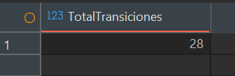

## Pregunta 8 — Funciones: estado en una fecha y SLA por prioridad

**Paso 1 — Crear las funciones**

```sql
CREATE OR ALTER FUNCTION modelado.fn_EstadoEnFecha
(
    @id_ticket   INT,
    @fecha_corte DATETIME
)
RETURNS VARCHAR(20)
AS
BEGIN
    DECLARE @estado VARCHAR(20);

    SELECT TOP (1) @estado = e.descripcion
    FROM modelado.Transicion tr
    INNER JOIN modelado.EstadoTransicion e
            ON e.id_estado_transicion = tr.id_transicion_despues
    WHERE tr.id_ticket = @id_ticket
      AND tr.fecha <= @fecha_corte
    ORDER BY tr.fecha DESC, tr.id_transicion DESC;

    RETURN ISNULL(@estado, 'Nuevo');
END;
GO

CREATE OR ALTER FUNCTION modelado.fn_SlaMinutos
(
    @id_prioridad INT
)
RETURNS INT
AS
BEGIN
    RETURN CASE @id_prioridad
               WHEN 1 THEN 4  * 60
               WHEN 2 THEN 8  * 60
               WHEN 3 THEN 24 * 60
               WHEN 4 THEN 72 * 60
           END;
END;
GO
```

**Paso 2 — Consultar los tickets abiertos**

```sql
SELECT
    t.codigo_ticket                                  AS CodigoTicket,
    p.descripcion                                    AS Prioridad,
    modelado.fn_EstadoEnFecha(t.id_ticket, '2026-10-08') AS EstadoAlCorte,
    modelado.fn_SlaMinutos(t.id_prioridad)           AS SlaMinutos,
    modelado.fn_SlaMinutos(t.id_prioridad) / 60      AS SlaHoras
FROM modelado.Ticket t
INNER JOIN modelado.Prioridad p
        ON p.id_prioridad = t.id_prioridad
WHERE modelado.fn_EstadoEnFecha(t.id_ticket, '2026-10-08') NOT IN ('Cerrado', 'Cancelado')
ORDER BY SlaMinutos, CodigoTicket;
```
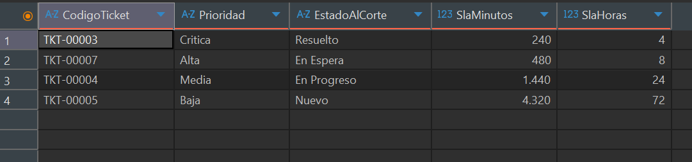

## Pregunta 9 — Tablero de riesgo de SLA a una fecha de corte

Requiere las funciones creadas en la pregunta 8.

**Paso 1 — Crear el procedimiento**

```sql
CREATE OR ALTER PROCEDURE modelado.usp_TableroRiesgoSLA
    @fecha_corte    DATETIME,
    @id_equipo      INT = NULL,
    @total_vencidos INT OUTPUT
AS
BEGIN
    SET NOCOUNT ON;

    DROP TABLE IF EXISTS #riesgo;

    WITH base AS (
        SELECT
            t.codigo_ticket,
            e.descripcion                                          AS equipo,
            p.descripcion                                          AS prioridad,
            modelado.fn_EstadoEnFecha(t.id_ticket, @fecha_corte)   AS estado_corte,
            modelado.fn_SlaMinutos(t.id_prioridad)                 AS sla_min,
            DATEDIFF(MINUTE, t.fecha, @fecha_corte)                AS min_transcurridos
        FROM modelado.Ticket t
        INNER JOIN modelado.Prioridad p ON p.id_prioridad = t.id_prioridad
        LEFT  JOIN modelado.Equipo e    ON e.id_equipo    = t.id_equipo
        WHERE t.fecha <= @fecha_corte
          AND (@id_equipo IS NULL OR t.id_equipo = @id_equipo)
    ),
    abiertos AS (
        SELECT
            *,
            CAST(100.0 * min_transcurridos / sla_min AS DECIMAL(6,2)) AS pct_consumido
        FROM base
        WHERE estado_corte NOT IN ('Resuelto', 'Cerrado', 'Cancelado')
    )
    SELECT
        codigo_ticket     AS CodigoTicket,
        equipo            AS Equipo,
        prioridad         AS Prioridad,
        estado_corte      AS EstadoAlCorte,
        sla_min           AS SlaMin,
        min_transcurridos AS MinTranscurridos,
        pct_consumido     AS PctConsumido,
        CASE
            WHEN pct_consumido >= 100 THEN 'Vencido'
            WHEN pct_consumido >= 75  THEN 'En riesgo'
            ELSE 'En tiempo'
        END               AS Semaforo
    INTO #riesgo
    FROM abiertos;

    SELECT @total_vencidos = COUNT(*)
    FROM #riesgo
    WHERE Semaforo = 'Vencido';

    SELECT *
    FROM #riesgo
    ORDER BY PctConsumido DESC;
END;
```

**Paso 2 — Ejecutarlo**

```sql
DECLARE @vencidos INT;

-- Todos los equipos
EXEC modelado.usp_TableroRiesgoSLA
     @fecha_corte    = '2026-10-03T16:00:00',
     @total_vencidos = @vencidos OUTPUT;
SELECT @vencidos AS TotalVencidos;                -- 1

-- Solo Cloud
EXEC modelado.usp_TableroRiesgoSLA
     @fecha_corte    = '2026-10-03T16:00:00',
     @id_equipo      = 6,
     @total_vencidos = @vencidos OUTPUT;
SELECT @vencidos AS TotalVencidos;                -- 0
```
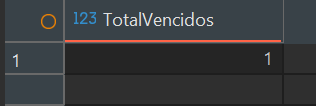
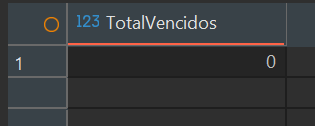
---

## Challenge — ¿Estamos cumpliendo los SLA de atención?

### Paso 1 — Base de SLA por ticket

Se guarda en una tabla temporal para reutilizarla en los pasos siguientes.

```sql
DROP TABLE IF EXISTS #sla;

WITH resolucion AS (
    SELECT id_ticket, MIN(fecha) AS fecha_resolucion
    FROM modelado.Transicion
    WHERE id_transicion_despues = 5          -- 5 = Resuelto
    GROUP BY id_ticket
),
base AS (
    SELECT
        t.id_ticket,
        t.codigo_ticket,
        t.id_equipo,
        t.id_asignatario,
        t.id_prioridad,
        p.descripcion AS prioridad,
        CASE t.id_prioridad
            WHEN 1 THEN 4  * 60
            WHEN 2 THEN 8  * 60
            WHEN 3 THEN 24 * 60
            WHEN 4 THEN 72 * 60
        END AS sla_minutos,
        DATEDIFF(MINUTE, t.fecha, r.fecha_resolucion) AS minutos_resolucion
    FROM modelado.Ticket t
    INNER JOIN modelado.Prioridad p ON p.id_prioridad = t.id_prioridad
    LEFT JOIN resolucion r          ON r.id_ticket = t.id_ticket
    WHERE NOT EXISTS (                       -- 7 = Cancelado
        SELECT 1
        FROM modelado.Transicion c
        WHERE c.id_ticket = t.id_ticket
          AND c.id_transicion_despues = 7
    )
)
SELECT
    *,
    CASE
        WHEN minutos_resolucion IS NULL         THEN 'Sin resolver'
        WHEN minutos_resolucion <= sla_minutos  THEN 'Cumple'
        ELSE 'Incumple'
    END AS resultado
INTO #sla
FROM base;
```


### Paso 2 — Resultado por ticket (preguntas 1 y 2)

```sql
SELECT
    codigo_ticket,
    prioridad,
    sla_minutos,
    minutos_resolucion,
    resultado
FROM #sla
ORDER BY id_prioridad, codigo_ticket;
```
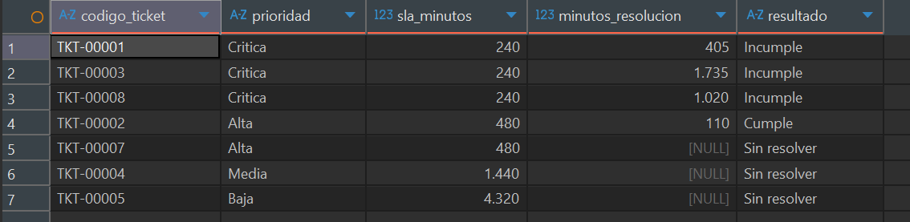

### Paso 3 — Cumplimiento por equipo y prioridad (preguntas 3 y 4)

```sql
SELECT
    e.descripcion AS Equipo,
    s.prioridad   AS Prioridad,
    COUNT(*)      AS Tickets,
    SUM(CASE WHEN s.resultado = 'Cumple'       THEN 1 ELSE 0 END) AS Cumplen,
    SUM(CASE WHEN s.resultado = 'Incumple'     THEN 1 ELSE 0 END) AS Incumplen,
    SUM(CASE WHEN s.resultado = 'Sin resolver' THEN 1 ELSE 0 END) AS SinResolver,
    CAST(100.0 * SUM(CASE WHEN s.resultado = 'Cumple' THEN 1 ELSE 0 END) / COUNT(*) AS DECIMAL(5,2)) AS PctCumplimiento,
    CAST(100.0 * SUM(CASE WHEN s.resultado = 'Incumple' THEN 1 ELSE 0 END)
         / NULLIF(SUM(SUM(CASE WHEN s.resultado = 'Incumple' THEN 1 ELSE 0 END)) OVER (), 0)
         AS DECIMAL(5,2)) AS PctSobreTotalIncumplimientos
FROM #sla s
LEFT JOIN modelado.Equipo e ON e.id_equipo = s.id_equipo
GROUP BY e.descripcion, s.id_prioridad, s.prioridad
ORDER BY s.id_prioridad, Incumplen DESC;
```
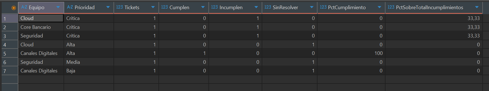

### Paso 4 — Asignatarios con más tickets sin resolver (pregunta 5)

```sql
SELECT
    u.nombre + ' ' + u.apellido AS Asignatario,
    COUNT(*)                    AS TicketsSinResolver,
    RANK() OVER (ORDER BY COUNT(*) DESC) AS Ranking
FROM #sla s
INNER JOIN modelado.Usuario u ON u.id_usuario = s.id_asignatario
WHERE s.resultado = 'Sin resolver'
GROUP BY u.nombre, u.apellido
ORDER BY Ranking;
```
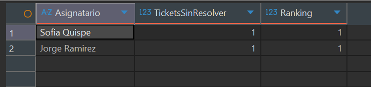

### Paso 5 — Concentración de problemas por equipo (pregunta 6)

Problema = ticket que no cumple (`Incumple` + `Sin resolver`).

```sql
WITH por_equipo AS (
    SELECT
        e.descripcion AS Equipo,
        COUNT(*)      AS Problemas
    FROM #sla s
    LEFT JOIN modelado.Equipo e ON e.id_equipo = s.id_equipo
    WHERE s.resultado <> 'Cumple'
    GROUP BY e.descripcion
)
SELECT
    Equipo,
    Problemas,
    CAST(100.0 * Problemas / SUM(Problemas) OVER () AS DECIMAL(5,2)) AS PctDelTotal,
    CAST(100.0 * SUM(Problemas) OVER (ORDER BY Problemas DESC, Equipo
                                      ROWS BETWEEN UNBOUNDED PRECEDING AND CURRENT ROW)
         / SUM(Problemas) OVER () AS DECIMAL(5,2)) AS PctAcumulado
FROM por_equipo
ORDER BY Problemas DESC, Equipo;
```
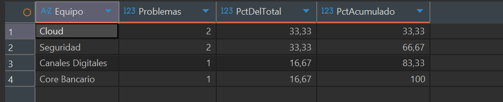


